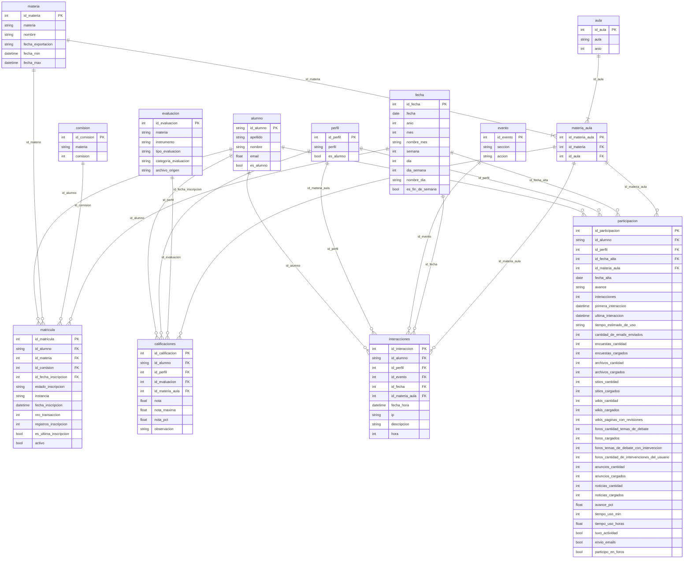

# Diagrama entidad-relación del modelo

Tablas que deja `cargar_datos.py` en `data/processed`. El modelo es una **constelación**: cuatro esquemas en estrella que comparten las mismas dimensiones. Cada tabla de hechos está en el centro de su estrella, con claves y medidas, y lo descriptivo vive en las dimensiones. Todas están a un solo paso del hecho, salvo `materia` y `aula`, a las que se llega pasando por la tabla intermedia `materia_aula`.

## Cómo leer el diagrama

Cada renglón tiene el tipo de dato, el nombre de la columna y, si corresponde, el tipo de clave.

| Marca | Significado |
|---|---|
| `PK` | Clave primaria: identifica la fila y no se repite |
| `FK` | Clave foránea: apunta a la clave primaria de una dimensión |



## Las cuatro estrellas

| Tabla de hechos | Una fila es | Dimensiones | Dashboards que alimenta |
|---|---|---|---|
| `interacciones` | Un clic o acceso de un usuario | alumno, materia_aula (materia y aula), perfil, evento, fecha | 1 General, 2 Participación, 3 Trazabilidad, 5 Notas vs. participación, 6 Individual, 7 Matrícula y alertas |
| `participacion` | El resumen de un usuario en un aula, a la fecha de exportación | alumno, materia_aula (materia y aula), perfil, fecha (alta) | 1 General, 2 Participación, 5 Notas vs. participación, 6 Individual |
| `calificaciones` | La nota de un alumno en un examen | alumno, materia_aula (materia y aula), perfil, evaluacion | 1 General, 4 Rendimiento, 5 Notas vs. participación, 6 Individual |
| `matricula` | Una inscripción de un alumno a una materia | alumno, materia, comision, fecha (inscripción) | 7 Matrícula y alertas |

Las dimensiones `alumno` y `materia` se alcanzan desde las cuatro estrellas: son las que permiten cruzar una tabla de hechos con otra (por ejemplo notas contra participación, o padrón contra actividad).

## Cómo se usa desde un dashboard

```python
from cargar_datos import leer_tabla

notas = leer_tabla("calificaciones")                       # solo alumnos, con las dimensiones pegadas
todos = leer_tabla("interacciones", solo_alumnos=False)    # incluye tutores, coordinadores e invitados
crudo = leer_tabla("matricula", con_dimensiones=False)     # tal como está en el CSV
```

`leer_tabla()` cruza cada clave con su dimensión y devuelve una tabla plana, con `materia`, `aula`, `perfil`, `seccion`, `accion`, `instrumento`, `apellido` y demás como columnas. No hace falta cruzar nada a mano.

## Decisiones del modelo

- **Materia y aula, muchos a muchos, con tabla intermedia.** Una materia puede tener varias aulas y un aula puede compartirse entre materias. `materia_aula` tiene una fila por combinación, con clave propia (`id_materia_aula`) y dos claves foráneas (`id_materia` e `id_aula`). Los hechos que ocurren en un aula (`interacciones`, `participacion` y `calificaciones`) apuntan a ella con una sola clave foránea, en lugar de llevar las dos por separado. El costo es que `materia` y `aula` quedan a dos pasos del hecho, lo que en la teoría es un copo de nieve en esa rama; `leer_tabla()` hace los dos cruces sola. Con los datos actuales cada materia tiene un aula sola.
- **El padrón se relaciona con la materia, no con el aula.** El archivo de matriculados trae la comisión pero no el aula del campus.
- **Todas las tablas de hechos tienen un número propio como clave primaria**, y además una combinación que no se puede repetir. El número identifica la fila; la combinación es la regla que evita duplicados, porque dos filas repetidas tendrían números distintos y pasarían inadvertidas.

  | Tabla | Clave primaria | Combinación que no se repite | Por qué |
  |---|---|---|---|
  | `calificaciones` | `id_calificacion` | `id_alumno` + `id_evaluacion` | Un alumno tiene una sola nota por examen |
  | `participacion` | `id_participacion` | `id_alumno` + `id_materia_aula` | El campus da un resumen por usuario y aula |
  | `matricula` | `id_matricula` | `nro_transaccion` | Es el número que el campus le pone a cada inscripción. Alumno, materia y día no alcanzan: hay 4 casos de dos inscripciones del mismo alumno el mismo día |
  | `interacciones` | `id_interaccion` | Ninguna | El mismo alumno repite la misma acción en el mismo segundo 151 veces, así que solo el número propio identifica un clic |
  | `materia_aula` | `id_materia_aula` | `id_materia` + `id_aula` | Una fila por combinación de materia y aula |

  La carga avisa si una clave primaria o una de estas combinaciones queda repetida o vacía.
- **Claves numéricas y claves de texto.** Las tablas tienen una clave numérica propia (`id_materia`, `id_aula`, `id_comision`, `id_calificacion`...) que se asigna en cada carga: en las dimensiones por orden alfabético y en los hechos por orden de lectura. Todas las tablas se regeneran juntas, así que siempre coinciden entre sí. Además, `materia.materia`, `aula.aula` y `perfil.perfil` son únicas: son el nombre con el que el dato llega del campus, y `materia.materia` es la clave de `reglas_materias.json`. La excepción es `alumno`, que usa como clave el identificador del campus (`ALU_1001`), y `fecha`, cuya clave es la fecha escrita como número (`20250805`).
- **No se descartan perfiles.** Tutores, coordinadores e invitados quedan en los hechos con su `id_perfil`. `leer_tabla()` devuelve solo alumnos salvo que se le pida `solo_alumnos=False`.
- **No se descartan inscripciones.** `es_ultima_inscripcion` marca la más reciente de cada alumno en la materia, y `activo` es verdadero solo si esa última está aceptada. Para contar inscriptos vigentes se filtra por `activo`.
- **No se descartan columnas del campus.** Las transformadas se agregan al lado de la original: `tiempo_estimado_de_uso` (texto `10:07`) convive con `tiempo_uso_min` y `tiempo_uso_horas`, y `avance` con `avance_pct`.
- **La fecha cumple tres papeles.** La misma dimensión `fecha` se usa para el día de la interacción (`id_fecha`), el del alta en el aula (`id_fecha_alta`) y el de la inscripción (`id_fecha_inscripcion`).
- **Lugar reservado para la tabla de equivalencias de eventos.** La categoría de cada acción (clics, materiales, exámenes) se agrega como una columna más de `evento`, sin tocar los hechos.

## Valores que toman algunas columnas

Son los que aparecen en los datos exportados el 24/10/2025, no una simplificación hecha en la carga.

| Columna | Valores |
|---|---|
| `perfil.perfil` | Alumnos, Coordinadores, Invitados, Tutores |
| `matricula.estado_inscripcion` | Aceptada (492 filas), Baja (21 filas) |
| `matricula.instancia` | Regularidad (513 filas) |
| `evaluacion.categoria_evaluacion` | autoevaluacion (7 exámenes), actividad (5), parcial (2), evaluacion_semanal (2), recuperatorio (1). Se deduce del nombre del examen; uno que no encaje en ninguna queda como "otro" |
| `calificaciones.observacion` | aprobada (1.712 filas), no aprobada (81 filas) |

## Diccionario de datos

El ejemplo es el primer valor no vacío de cada columna.

### `interacciones` (159.118 filas)

| Clave | Columna | Tipo | Ejemplo |
|---|---|---|---|
| PK | `id_interaccion` | int | 1 |
| FK | `id_alumno` | string | ALU_1001 |
| FK | `id_perfil` | int | 1 |
| FK | `id_evento` | int | 40 |
| FK | `id_fecha` | int | 20250805 |
| FK | `id_materia_aula` | int | 2 |
|  | `fecha_hora` | datetime | 2025-08-05 18:05:40 |
|  | `ip` | string | 10.10.3.252 |
|  | `descripcion` | string | Acceso a la sección 'Inicio' |
|  | `hora` | int | 18 |

### `participacion` (986 filas)

| Clave | Columna | Tipo | Ejemplo |
|---|---|---|---|
| PK | `id_participacion` | int | 1 |
| FK | `id_alumno` | string | ALU_1001 |
| FK | `id_perfil` | int | 1 |
| FK | `id_fecha_alta` | int | 20250805 |
| FK | `id_materia_aula` | int | 2 |
|  | `fecha_alta` | date | 2025-08-05 |
|  | `avance` | string | 47 |
|  | `interacciones` | int | 406 |
|  | `primera_interaccion` | datetime | 2025-08-05 18:05:40 |
|  | `ultima_interaccion` | datetime | 2025-10-21 20:15:05 |
|  | `tiempo_estimado_de_uso` | string | 03:23 |
|  | `cantidad_de_emails_enviados` | int | 0 |
|  | `encuestas_cantidad` | int | 0 |
|  | `encuestas_cargados` | int | 0 |
|  | `archivos_cantidad` | int | 0 |
|  | `archivos_cargados` | int | 0 |
|  | `sitios_cantidad` | int | 1 |
|  | `sitios_cargados` | int | 0 |
|  | `wikis_cantidad` | int | 0 |
|  | `wikis_cargados` | int | 0 |
|  | `wikis_paginas_con_revisiones` | int | 0 |
|  | `foros_cantidad_temas_de_debate` | int | 0 |
|  | `foros_cargados` | int | 0 |
|  | `foros_temas_de_debate_con_intervencion` | int | 0 |
|  | `foros_cantidad_de_intervenciones_del_usuario` | int | 0 |
|  | `anuncios_cantidad` | int | 0 |
|  | `anuncios_cargados` | int | 0 |
|  | `noticias_cantidad` | int | 6 |
|  | `noticias_cargados` | int | 0 |
|  | `avance_pct` | float | 47.0 |
|  | `tiempo_uso_min` | int | 203 |
|  | `tiempo_uso_horas` | float | 3.38 |
|  | `tuvo_actividad` | bool | True |
|  | `envio_emails` | bool | False |
|  | `participo_en_foros` | bool | False |

### `calificaciones` (1.793 filas)

| Clave | Columna | Tipo | Ejemplo |
|---|---|---|---|
| PK | `id_calificacion` | int | 1 |
| FK | `id_alumno` | string | ALU_1004 |
| FK | `id_perfil` | int | 1 |
| FK | `id_evaluacion` | int | 4 |
| FK | `id_materia_aula` | int | 2 |
|  | `nota` | float | 100.0 |
|  | `nota_maxima` | float | 100.0 |
|  | `nota_pct` | float | 100.0 |
|  | `observacion` | string | aprobada |

### `matricula` (513 filas)

| Clave | Columna | Tipo | Ejemplo |
|---|---|---|---|
| PK | `id_matricula` | int | 1 |
| FK | `id_alumno` | string | ALU_1001 |
| FK | `id_materia` | int | 2 |
| FK | `id_comision` | int | 2 |
| FK | `id_fecha_inscripcion` | int | 20250815 |
|  | `estado_inscripcion` | string | Aceptada |
|  | `instancia` | string | Regularidad |
|  | `fecha_inscripcion` | datetime | 2025-08-15 10:30:13 |
|  | `nro_transaccion` | int | 300847 |
|  | `registros_inscripcion` | int | 1 |
|  | `es_ultima_inscripcion` | bool | True |
|  | `activo` | bool | True |

### `alumno` (334 filas)

| Clave | Columna | Tipo | Ejemplo |
|---|---|---|---|
| PK | `id_alumno` | string | ALU_1001 |
|  | `apellido` | string | Gómez |
|  | `nombre` | string | Manuel |
|  | `email` | float | (vacía en todos los registros) |
|  | `es_alumno` | bool | True |

### `materia` (3 filas)

| Clave | Columna | Tipo | Ejemplo |
|---|---|---|---|
| PK | `id_materia` | int | 1 |
|  | `materia` | string | algebra |
|  | `nombre` | string | Álgebra |
|  | `fecha_exportacion` | string | 24/10/2025 |
|  | `fecha_min` | datetime | 2025-08-05 10:19:14 |
|  | `fecha_max` | datetime | 2025-10-24 10:16:39 |

### `aula` (3 filas)

| Clave | Columna | Tipo | Ejemplo |
|---|---|---|---|
| PK | `id_aula` | int | 1 |
|  | `aula` | string | TUCD-MD-Algoritmos y Estructuras de Datos 2025 |
|  | `anio` | int | 2025 |

### `materia_aula` (3 filas)

| Clave | Columna | Tipo | Ejemplo |
|---|---|---|---|
| PK | `id_materia_aula` | int | 1 |
| FK | `id_materia` | int | 1 |
| FK | `id_aula` | int | 3 |

### `perfil` (4 filas)

| Clave | Columna | Tipo | Ejemplo |
|---|---|---|---|
| PK | `id_perfil` | int | 1 |
|  | `perfil` | string | Alumnos |
|  | `es_alumno` | bool | True |

### `fecha` (143 filas)

| Clave | Columna | Tipo | Ejemplo |
|---|---|---|---|
| PK | `id_fecha` | int | 20250604 |
|  | `fecha` | date | 2025-06-04 |
|  | `anio` | int | 2025 |
|  | `mes` | int | 6 |
|  | `nombre_mes` | string | junio |
|  | `semana` | int | 23 |
|  | `dia` | int | 4 |
|  | `dia_semana` | int | 3 |
|  | `nombre_dia` | string | miércoles |
|  | `es_fin_de_semana` | bool | False |

### `evento` (95 filas)

| Clave | Columna | Tipo | Ejemplo |
|---|---|---|---|
| PK | `id_evento` | int | 1 |
|  | `seccion` | string | Archivos |
|  | `accion` | string | Acceder |

### `evaluacion` (17 filas)

| Clave | Columna | Tipo | Ejemplo |
|---|---|---|---|
| PK | `id_evaluacion` | int | 1 |
|  | `materia` | string | algebra |
|  | `instrumento` | string | 1° Parcial |
|  | `tipo_evaluacion` | string | 1_parcial |
|  | `categoria_evaluacion` | string | parcial |
|  | `archivo_origen` | string | calificaciones_alumnos_20251024_114944.xlsx |

### `comision` (3 filas)

| Clave | Columna | Tipo | Ejemplo |
|---|---|---|---|
| PK | `id_comision` | int | 1 |
|  | `materia` | string | algebra |
|  | `comision` | int | 2319 |
